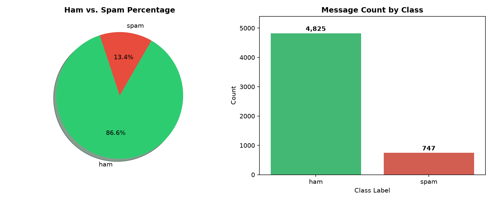
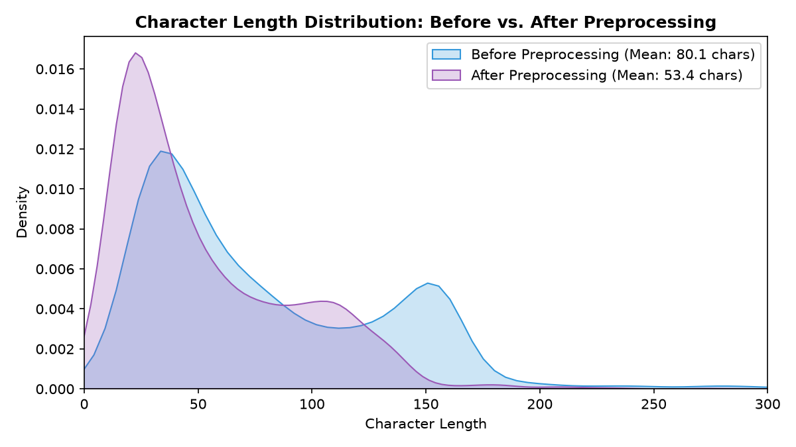
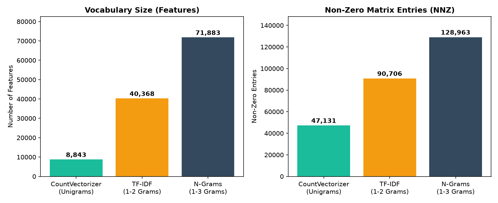

# SMS Spam Preprocessing & Vectorization (NLP)

An end-to-end Natural Language Processing (NLP) text preparation project on the **SMS Spam Collection (`spam.csv`)** dataset, demonstrating each preprocessing and feature vectorization stage with **Before vs. After** comparisons using Python list comprehensions, NLTK (`word_tokenize`, `stopwords`, `WordNetLemmatizer`), and `scikit-learn` vectorizers.

---

## Overview

Raw SMS messages contain irregular casing, punctuation noise, high-frequency stopwords, and inflected word forms. This project transforms raw text into clean, machine-learning-ready numerical feature matrices through two core stages:

1. **Text Preprocessing Pipeline (List Comprehension + Lambda):**
   - **Lowercasing & Punctuation Removal:** Normalizes case and strips `string.punctuation` characters.
   - **Tokenization:** Splits normalized text into lexical tokens via NLTK `word_tokenize`.
   - **Stopwords Removal:** Filters out non-informative English stopwords (`nltk.corpus.stopwords`).
   - **Lemmatization:** Reduces inflected words to valid dictionary lemmas using `WordNetLemmatizer` (chosen over stemming to prevent over-stemming and preserve true vocabulary roots).
2. **Feature Vectorization:**
   - **Count Vectorization (`CountVectorizer`):** Builds a document-term frequency matrix of unigrams.
   - **N-Grams Vectorization (`ngram_range=(1, 3)`):** Captures local word sequences (unigrams, bigrams, trigrams).
   - **TF-IDF Vectorization (`TfidfVectorizer(ngram_range=(1, 2))`):** Weights terms by importance across the corpus while down-weighting ubiquitous tokens.

---

## Dataset

- **Source:** `spam.csv` (`5,572` SMS messages, `0` missing values after selecting `v1` and `v2`)
- **Columns:**
  - `label`: Target class (`ham` = `4,825` messages / `86.59%`, `spam` = `747` messages / `13.41%`)
  - `body_text`: Raw SMS text content

---

## Text Preprocessing: Before vs. After

| Step | Method Used | Example (`Row 4 — Ham`) |
| :--- | :--- | :--- |
| **Raw Text (`body_text`)** | Original SMS | `"Nah I don't think he goes to usf, he lives around here though"` |
| **1. Lowercase & No Punctuation** | `[char.lower() for char in text if char not in string.punctuation]` | `"nah i dont think he goes to usf he lives around here though"` |
| **2. Tokenization** | `word_tokenize(text)` | `['nah', 'i', 'dont', 'think', 'he', 'goes', 'to', 'usf', 'he', 'lives', 'around', 'here', 'though']` |
| **3. Stopwords Removal** | `[word for word in tokens if word not in stopwords_En]` | `['nah', 'dont', 'think', 'goes', 'usf', 'lives', 'around', 'though']` |
| **4. Lemmatization** | `[wn.lemmatize(word) for word in tokens]` | `['nah', 'dont', 'think', 'go', 'usf', 'life', 'around', 'though']` |
| **5. Final `cleaned_text`** | Unified `clean_text(text)` function | `"nah dont think go usf life around though"` |

---

## Visual Analysis

### 1. Class Distribution (Ham vs. Spam)


### 2. Text Length Distribution: Before vs. After Preprocessing


### 3. Vectorization Comparison: Vocabulary Size & Non-Zero Entries


---

## Vectorization Results Summary

| Vectorizer | Configuration | Matrix Shape | Vocabulary Size | Non-Zero Entries (NNZ) | Sparsity |
| :--- | :---: | :---: | :---: | :---: | :---: |
| **Count Vectorizer** | Unigrams `(1, 1)` | `(5572, 8843)` | `8,843` | `47,131` | `99.90%` |
| **TF-IDF Vectorizer** | Unigrams + Bigrams `(1, 2)` | `(5572, 40368)` | `40,368` | `90,706` | `99.96%` |
| **N-Grams Vectorizer** | Unigrams to Trigrams `(1, 3)` | `(5572, 71883)` | `71,883` | `128,963` | `99.97%` |

---

## Project Structure

```text
SMS-Spam-Preprocessing-Vectorization/
├── SMS_Spam_Preprocessing_Vectorization.ipynb   # Executed notebook with concise English analysis
├── sms_spam_preprocessing_vectorization.py      # Standalone reproducible Python script
├── spam.csv                                     # SMS Spam Collection dataset
├── requirements.txt                             # Dependencies
├── .gitignore
├── README.md
└── figures/                                     # Generated high-resolution visualizations
    ├── 01_class_distribution.png
    ├── 02_preprocessing_length_reduction.png
    └── 03_vectorization_comparison.png
```

---

## Quick Start

```bash
pip install -r requirements.txt
python sms_spam_preprocessing_vectorization.py
```

Or open and run **`SMS_Spam_Preprocessing_Vectorization.ipynb`** in Jupyter Notebook / VS Code.
